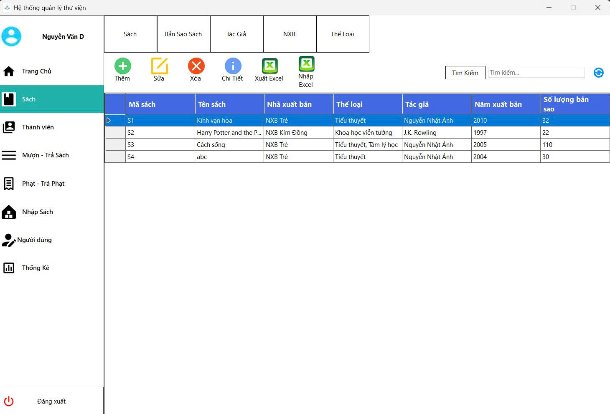
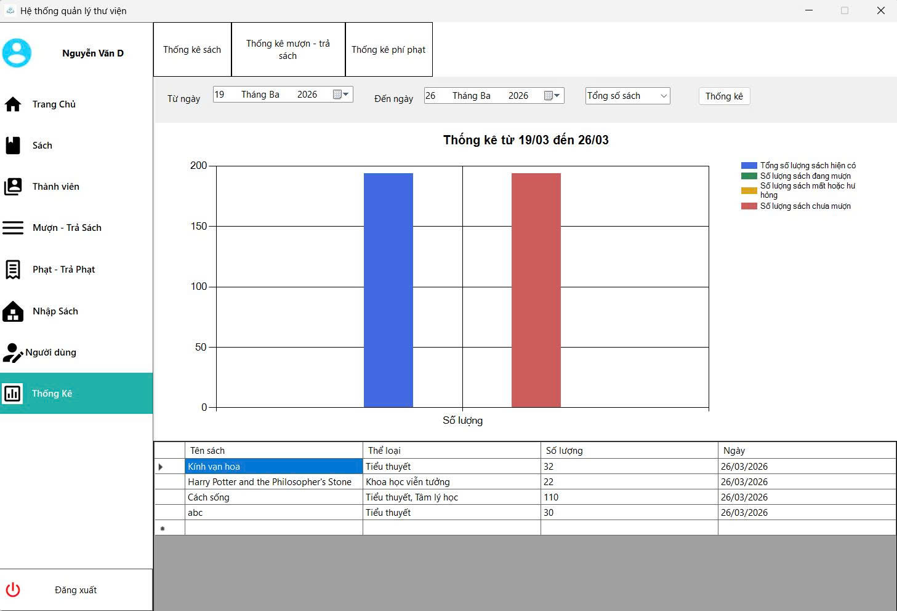

# 📚 Library Management System (LMS)

Hệ thống quản lý thư viện được xây dựng bằng **C# Windows Forms** và **.NET 8**, sử dụng **MySQL** làm cơ sở dữ liệu.

---

## 🗂️ Kiến trúc dự án

Dự án theo mô hình **N-Tier**:

```
UI (WinForms) → Services → Repositories → Data (DbContext) → MySQL Database
```

| Project | Vai trò |
|---|---|
| `LMS.Views` | Giao diện người dùng (Forms, UserControls) |
| `LMS.Services` | Xử lý nghiệp vụ |
| `LMS.Repositories` | Truy cập dữ liệu |
| `LMS.Data` | DbContext, Migrations, seed data |
| `LMS.Models` | Entities và DTOs |
| `LMS.Utils` | Các helper dùng chung |

> 🔗 Sơ đồ database: https://www.drawdb.app/editor?shareId=5bd00b421e07764f9c3fa0495f839703

---
## 🎨 Giao diện phần mềm


*Màn hình quản lý sách*


*Màn hình thống kê sách*

---
## ⚙️ Yêu cầu cài đặt

Trước khi chạy dự án, đảm bảo máy đã có:

- [.NET 8 SDK](https://dotnet.microsoft.com/download/dotnet/8.0)
- [MySQL Server 8.x](https://dev.mysql.com/downloads/mysql/) (chạy ở port `3306`)
- [Visual Studio 2022](https://visualstudio.microsoft.com/) (khuyến nghị) hoặc Visual Studio Code
- [EF Core CLI Tools](https://learn.microsoft.com/en-us/ef/core/cli/dotnet) (dùng để migration)

---

## 🚀 Hướng dẫn chạy dự án

### Bước 1 — Clone repository

```bash
git clone <repository-url>
cd LibraryManagementSystem
```

### Bước 2 — Cấu hình kết nối database

Mở file `LMS.Data/Data/LibraryDbContext.cs` và chỉnh sửa chuỗi kết nối cho phù hợp với MySQL của bạn:

```csharp
private readonly string connectionString =
    @"server=localhost;port=3306;user=root;password=;database=library";
```

> **Lưu ý:** Thay `password=` bằng mật khẩu MySQL của bạn nếu có.

### Bước 3 — Khởi tạo database

Mở terminal tại thư mục gốc của project và chạy lệnh sau để tạo database từ migrations:

```bash
dotnet ef database update --project LMS.Data --startup-project LMS.Views.csproj
```

### Bước 4 — Nhập dữ liệu mẫu (Seed Data)

Sau khi database được tạo, import file seed để có dữ liệu mẫu:

```bash
mysql -u root -p library < LMS.Data/Data/seed.sql
```

> Hoặc mở file `LMS.Data/Data/seed.sql` và chạy trực tiếp trong **MySQL Workbench** / **HeidiSQL**.

### Bước 5 — Build và chạy ứng dụng

**Dùng Visual Studio:**
1. Mở file `LibraryManagementSystem.sln`
2. Đặt `LMS.Views` làm Startup Project
3. Nhấn `F5` hoặc nút **Run**

**Dùng CLI:**
```bash
dotnet run --project LMS.Views.csproj
```

---

## 🔐 Tài khoản đăng nhập mặc định

| Tài khoản | Mật khẩu | Vai trò |
|---|---|---|
| `admin` | `123456` | Quản trị viên (toàn quyền) |

---

## 🛠️ Các lệnh Entity Framework thường dùng

> Chạy các lệnh dưới đây từ thư mục gốc của project.

### Migration

```bash
# Tạo migration mới
dotnet ef migrations add <TênMigration> --project LMS.Data --startup-project LMS.Views.csproj

# Xem danh sách migrations
dotnet ef migrations list --project LMS.Data --startup-project LMS.Views.csproj

# Xóa migration vừa tạo
dotnet ef migrations remove --project LMS.Data --startup-project LMS.Views.csproj
```

### Database

```bash
# Tạo hoặc cập nhật database theo migration mới nhất
dotnet ef database update --project LMS.Data --startup-project LMS.Views.csproj

# Rollback về một migration cụ thể
dotnet ef database update <TênMigration> --project LMS.Data --startup-project LMS.Views.csproj

# Xóa toàn bộ database
dotnet ef database drop --project LMS.Data --startup-project LMS.Views.csproj
```

---

## 📦 Các package chính

| Package | Mục đích |
|---|---|
| `Pomelo.EntityFrameworkCore.MySql` | Kết nối MySQL với EF Core |
| `Microsoft.EntityFrameworkCore` | ORM chính |
| `ClosedXML` | Xuất file Excel |
| `WinForms.DataVisualization` | Vẽ biểu đồ thống kê |
